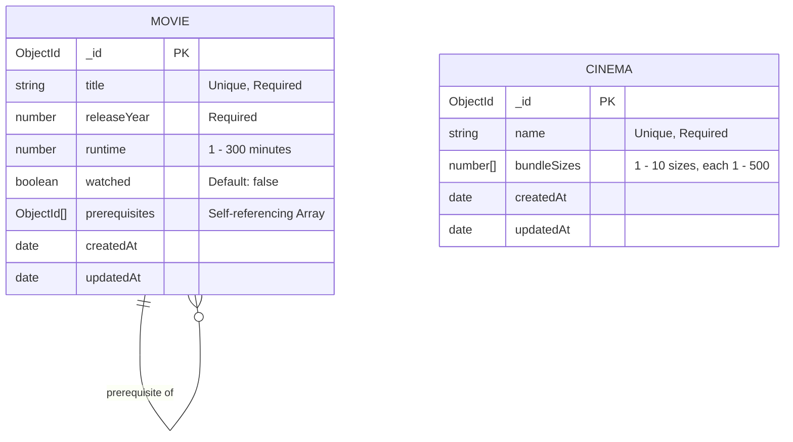

# Doomsday Ready — MCU Rewatch & Watch-Party Planner

**Doomsday Ready** is a full-stack web application designed for Marvel Cinematic Universe (MCU) fans to prepare for the premiere of **Avengers: Doomsday**. It maps film prerequisite dependencies, calculates optimal chronological rewatch paths, tracks watch progress, and calculates minimum seat bundle combinations for opening-night cinema watch parties.

Built as part of the **Blinto Full Stack Developer Internship Assessment (Talent Accelerator 2027)**.

---

## Table of Contents

- [Overview](#overview)
- [Key Features](#key-features)
- [Tech Stack](#tech-stack)
- [Data Model Diagram](#data-model-diagram)
- [Project Structure](#project-structure)
- [Getting Started](#getting-started)
  - [Prerequisites](#prerequisites)
  - [Backend Setup](#backend-setup)
  - [Frontend Setup](#frontend-setup)
  - [One-Command Launch with Docker Compose](#one-command-launch-with-docker-compose)
- [API Reference](#api-reference)
- [Algorithm Implementation Notice (Features 1 & 2)](#algorithm-implementation-notice-features-1--2)
- [AI Usage Disclosure](#ai-usage-disclosure)

---

## Overview

Ahead of *Avengers: Doomsday*, MCU fans need a reliable tool to catch up on interconnected lore without missing crucial story arcs. Moreover, cinemas sell opening-night seats only in fixed group bundles (e.g., bundles of 2, 5, 20 seats). This application provides a unified command center to:

1. **Manage MCU Films & Prerequisites**: Add movies, edit details, track watched status, and establish prerequisite links.
2. **Rewatch Order Sequence**: Formulate an ordered list of every predecessor film required before watching a target movie.
3. **Cinema & Bundle Management**: Register cinemas and their custom seat bundle sizes.
4. **Opening-Night Booking Optimization**: Determine the fewest bundles to seat groups of up to 10,000 fans without empty seats.

---

## Key Features

- **Cinematic Dark UI**: Modern Marvel-inspired dark aesthetic (`#0B0C10`), red accents, glassmorphic cards, and responsive design.
- **Interactive Dashboard**: Universe statistics (total movies, watched percentage, remaining runtime, active cinemas) and quick-action shortcuts.
- **Movie Catalog & Filtering**: Search movies by title, filter by Watched/Unwatched status, and toggle watched progress with instant feedback.
- **Rewatch Planner**: Select any target film (e.g., *Avengers: Doomsday*), review direct prerequisites, and trace the topological dependency sequence with progress bars.
- **Watch-Party Booking**: Enter any group size (1 to 10,000) and cinema to find exact minimum bundle combinations with clear breakdowns or "Booking Not Possible" notifications.
- **Resilient UI Integration**: Gracefully handles algorithm pending states (501 / algorithmPending) without crashing, displaying clear developer hook parameters.

---

## Tech Stack

### Backend
- **Runtime**: Node.js (ES Modules)
- **Framework**: Express.js
- **Database**: MongoDB with Mongoose ODM
- **Utilities**: CORS, Dotenv

### Frontend
- **Framework**: React 19 (Vite)
- **Styling**: Tailwind CSS v4
- **Routing**: React Router DOM v7
- **HTTP Client**: Axios
- **Icons & Alerts**: React Icons, React Hot Toast

---

## Data Model Diagram



---

## Project Structure

```text
blinto/
├── backend/
│   ├── src/
│   │   ├── config/
│   │   │   └── db.js              # MongoDB Mongoose connection
│   │   ├── models/
│   │   │   ├── Movie.js           # Movie Mongoose schema & validation
│   │   │   └── Cinema.js          # Cinema Mongoose schema & validation
│   │   ├── controllers/
│   │   │   ├── movieController.js # Movie CRUD & Rewatch Order endpoint hook
│   │   │   └── cinemaController.js# Cinema CRUD & Group Booking endpoint hook
│   │   ├── routes/
│   │   │   ├── movieRoutes.js     # /api/movies routes
│   │   │   └── cinemaRoutes.js    # /api/cinemas routes
│   │   ├── app.js                 # Express app configuration & middleware
│   │   ├── server.js              # Server boot & listener
│   │   └── seed.js                # Database seeder with sample MCU films & cinemas
│   ├── .env.example
│   ├── Dockerfile
│   └── package.json
│
├── frontend/
│   ├── src/
│   │   ├── components/
│   │   │   ├── Navbar.jsx         # Global cinematic navigation header
│   │   │   ├── MovieModal.jsx     # Add/Edit movie modal with prereq picker
│   │   │   ├── CinemaModal.jsx    # Add/Edit cinema with bundle tag manager
│   │   │   ├── Loader.jsx         # Loading spinner with status message
│   │   │   └── AlgorithmPendingCard.jsx # Graceful state for pending algorithms
│   │   ├── pages/
│   │   │   ├── Dashboard.jsx      # Mission overview & live universe stats
│   │   │   ├── MoviesPage.jsx     # Movie library, search & watched toggles
│   │   │   ├── RewatchPlannerPage.jsx # Feature 1 rewatch sequence consumer
│   │   │   ├── CinemasPage.jsx    # Cinema venues management
│   │   │   └── BookingPage.jsx    # Feature 2 watch-party bundle calculator
│   │   ├── helper/
│   │   │   └── api.js             # Centralized Axios instance
│   │   ├── App.jsx                # Main layout, Router, Toaster
│   │   ├── main.jsx               # React DOM entrypoint
│   │   └── index.css              # Tailwind CSS styles
│   ├── .env.example
│   ├── Dockerfile
│   ├── nginx.conf
│   └── package.json
│
├── docker-compose.yml             # Single-command Docker startup
└── README.md
```

---

## Getting Started

### Prerequisites

- [Node.js](https://nodejs.org/) (v18 or higher recommended)
- [MongoDB](https://www.mongodb.com/) (running locally or via MongoDB Atlas)
- [Docker & Docker Compose](https://www.docker.com/) *(optional for containerized deployment)*

---

### Backend Setup

1. Navigate to the backend directory:
   ```bash
   cd backend
   ```

2. Install dependencies:
   ```bash
   npm install
   ```

3. Create your `.env` configuration file:
   ```bash
   cp .env.example .env
   ```
   *Default values in `.env`:*
   ```env
   PORT=5000
   MONGO_URI=mongodb://localhost:27017/doomsday_ready
   CORS_ORIGIN=http://localhost:5173
   ```

4. *(Optional)* Seed initial assessment MCU movies and cinemas:
   ```bash
   npm run seed
   ```

5. Start the backend development server:
   ```bash
   npm run dev
   # or
   npm start
   ```
   Backend will be running on `http://localhost:5000`.

---

### Frontend Setup

1. Navigate to the frontend directory:
   ```bash
   cd frontend
   ```

2. Install dependencies:
   ```bash
   npm install
   ```

3. Create your `.env` configuration file:
   ```bash
   cp .env.example .env
   ```
   *Default values in `.env`:*
   ```env
   VITE_API_BASE_URL=http://localhost:5000/api
   ```

4. Start the Vite development server:
   ```bash
   npm run dev
   ```
   Open your browser at `http://localhost:5173`.

---

### One-Command Launch with Docker Compose

To run MongoDB, the Express backend, and the React frontend in isolated Docker containers:

```bash
docker compose up --build
```

- **Frontend**: `http://localhost:5173`
- **Backend API**: `http://localhost:5000`
- **MongoDB**: `localhost:27017`

---

## API Reference

All endpoints are exposed under `/api`:

### Movies API

| Method | Path | Description | Status Code |
| :--- | :--- | :--- | :--- |
| `GET` | `/api/movies` | List all MCU movies with populated prerequisites | `200 OK` |
| `POST` | `/api/movies` | Create a movie (validates runtime 1-300, unique title) | `201 Created` / `400` |
| `GET` | `/api/movies/:id` | Get details for a specific movie | `200 OK` / `404` |
| `PATCH` | `/api/movies/:id` | Update movie (watched status, runtime, prereqs) | `200 OK` / `400` / `409` |
| `DELETE`| `/api/movies/:id` | Delete movie and prune references | `200 OK` / `404` |
| `GET` | `/api/movies/:id/rewatch-order` | Calculate rewatch sequence *(Feature 1 hook)* | `200` / `501 Pending` |

### Cinemas API

| Method | Path | Description | Status Code |
| :--- | :--- | :--- | :--- |
| `GET` | `/api/cinemas` | List all registered cinema venues | `200 OK` |
| `POST` | `/api/cinemas` | Create cinema (1-10 bundle sizes, 1-500 seats each) | `201 Created` / `400` |
| `GET` | `/api/cinemas/:id` | Get cinema details | `200 OK` / `404` |
| `PATCH` | `/api/cinemas/:id` | Update cinema name or bundle sizes | `200 OK` / `400` |
| `DELETE`| `/api/cinemas/:id` | Delete cinema venue | `200 OK` / `404` |
| `GET` | `/api/cinemas/:id/booking?groupSize=X` | Calculate minimum bundles *(Feature 2 hook)* | `200` / `501 Pending` |

---

## Algorithm Implementation Notice (Features 1 & 2)

Per the strict requirements of this assessment:

### Feature 1: Rewatch Order & Circular Dependency Detection
- **Author Ownership**: The core algorithmic logic for:
  - Recursive dependency graph traversal
  - Circular dependency detection (`409 CIRCULAR_DEPENDENCY`)
  - Topological sorting
  - Watched movie counting and remaining unwatched runtime calculation
  **is reserved for the candidate (Rakib Biswash) to implement manually without third-party libraries.**
- **Integration Status**: The REST endpoint `GET /api/movies/:id/rewatch-order`, Mongoose models, and React UI are fully built and ready to receive the sorted array of movies and metadata.

### Feature 2: Watch-Party Group Booking Optimization
- **Author Ownership**: The core algorithmic logic for:
  - Minimum bundle calculation (Dynamic Programming / Unbounded Knapsack / Search)
  - Exact group size matching
  - Bundle breakdown generation
  **is reserved for the candidate (Rakib Biswash) to implement manually.**
- **Integration Status**: The endpoint `GET /api/cinemas/:id/booking?groupSize=X`, group size validation (1 to 10,000), cinema validation, and React booking UI (including breakdown cards and "Booking Not Possible" state) are fully wired and functional.

---

## AI Usage Disclosure

In compliance with the assessment guidelines regarding AI usage:
- **AI Assisted**: Project directory scaffolding, Express CRUD boilerplate, Mongoose validation rules, React Tailwind UI component layout, and Docker configurations.
- **Reserved for Manual Author Implementation**: All domain algorithms for Feature 1 (Topological Sort / Dependency Resolution) and Feature 2 (Dynamic Programming / Minimum Bundle Calculation) are reserved for the author to implement independently.
