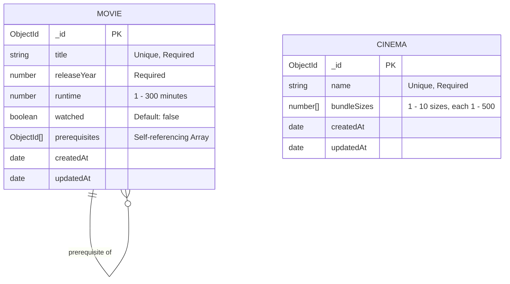

# Doomsday Ready — MCU Rewatch & Watch-Party Planner

**Doomsday Ready** is a full-stack web application designed for Marvel Cinematic Universe (MCU) fans to prepare for the premiere of **Avengers: Doomsday**. It maps film prerequisite dependencies, calculates optimal chronological rewatch paths, tracks watch progress, and calculates minimum seat bundle combinations for opening-night cinema watch parties.

Built for the **Blinto Full Stack Developer Internship Assessment (Talent Accelerator 2027)** by **Rakib Biswash**.

---

## Table of Contents

- [Live Demo & Repository](#live-demo--repository)
- [Overview](#overview)
- [Key Features](#key-features)
- [Tech Stack](#tech-stack)
- [Data Model Diagram](#data-model-diagram)
- [Project Structure](#project-structure)
- [Features 1 & 2 Algorithm Implementation](#features-1--2-algorithm-implementation)
  - [Feature 1: Movies & Rewatch Order](#feature-1-movies--rewatch-order)
  - [Feature 2: Cinemas & Watch-Party Group Booking](#feature-2-cinemas--watch-party-group-booking)
- [Getting Started](#getting-started)
  - [Prerequisites](#prerequisites)
  - [Backend Setup](#backend-setup)
  - [Frontend Setup](#frontend-setup)
- [API Reference](#api-reference)
- [AI Usage Disclosure](#ai-usage-disclosure)

---

## Live Demo & Repository

- **GitHub Repository**: [https://github.com/banrayndox/blinto-assesment](https://github.com/banrayndox/blinto-assesment)
- **Vercel Deployment**: [https://blinto-assesment.vercel.app](https://blinto-assesment.vercel.app)

---

## Overview

Ahead of *Avengers: Doomsday*, MCU fans need a reliable tool to catch up on interconnected lore without missing crucial story arcs. Moreover, cinemas sell opening-night seats only in fixed group bundles (e.g., bundles of 2, 5, 20 seats). This application provides a unified command center to:

1. **Manage MCU Films & Prerequisites**: Add movies, edit details, track watched status, and establish prerequisite links.
2. **Rewatch Order Sequence**: Formulate an ordered list of every predecessor film required before watching a target movie.
3. **Cinema & Bundle Management**: Register cinemas and their custom seat bundle sizes.
4. **Opening-Night Booking Optimization**: Determine the fewest bundles to seat groups of up to 10,000 fans without empty seats.

---

## Key Features

- **Cinematic Dark UI**: Modern Marvel-inspired dark aesthetic (`#0B0C10`), red accents, glassmorphic cards, and responsive design.
- **Interactive Dashboard**: Universe statistics (total movies, watched percentage, remaining runtime, active cinemas) and quick-action shortcuts.
- **Movie Catalog & Filtering**: Search movies by title, filter by Watched/Unwatched status, and toggle watched progress with instant feedback.
- **Rewatch Planner**: Select any target film (e.g., *Avengers: Doomsday*), review direct prerequisites, and trace the topological dependency sequence with progress bars.
- **Watch-Party Booking**: Enter any group size (1 to 10,000) and cinema to find exact minimum bundle combinations with clear breakdowns or "Booking Not Possible" notifications.

---

## Tech Stack

### Backend
- **Runtime**: Node.js (ES Modules)
- **Framework**: Express.js
- **Database**: MongoDB with Mongoose ODM
- **Utilities**: CORS, Dotenv

### Frontend
- **Framework**: React 19 (Vite)
- **Styling**: Tailwind CSS v4
- **Routing**: React Router DOM v7
- **HTTP Client**: Axios
- **Icons & Alerts**: React Icons, React Hot Toast

---

## Data Model Diagram



---

## Project Structure

```text
blinto/
├── backend/
│   ├── src/
│   │   ├── config/
│   │   │   └── db.js              # MongoDB Mongoose connection
│   │   ├── models/
│   │   │   ├── Movie.js           # Movie Mongoose schema & validation
│   │   │   └── Cinema.js          # Cinema Mongoose schema & validation
│   │   ├── controllers/
│   │   │   ├── movieController.js # Movie CRUD, Cycle Detection & Rewatch Order
│   │   │   └── cinemaController.js# Cinema CRUD & Group Booking Algorithm
│   │   ├── routes/
│   │   │   ├── movieRoutes.js     # /api/movies routes
│   │   │   └── cinemaRoutes.js    # /api/cinemas routes
│   │   ├── app.js                 # Express app configuration & middleware
│   │   ├── server.js              # Server boot & listener
│   │   └── seed.js                # Database seeder with sample MCU films & cinemas
│   ├── index.js                   # Serverless entrypoint for Vercel
│   ├── .env.example
│   └── package.json
│
├── frontend/
│   ├── src/
│   │   ├── components/
│   │   │   ├── Navbar.jsx         # Global cinematic navigation header
│   │   │   ├── MovieModal.jsx     # Add/Edit movie modal with prereq picker
│   │   │   ├── CinemaModal.jsx    # Add/Edit cinema with bundle tag manager
│   │   │   ├── Loader.jsx         # Loading spinner with status message
│   │   │   └── AlgorithmPendingCard.jsx # Fallback component for algorithm hooks
│   │   ├── pages/
│   │   │   ├── Dashboard.jsx      # Mission overview & live universe stats
│   │   │   ├── MoviesPage.jsx     # Movie library, search & watched toggles
│   │   │   ├── RewatchPlannerPage.jsx # Feature 1 rewatch sequence consumer
│   │   │   ├── CinemasPage.jsx    # Cinema venues management
│   │   │   └── BookingPage.jsx    # Feature 2 watch-party bundle calculator
│   │   ├── helper/
│   │   │   └── api.js             # Centralized Axios instance
│   │   ├── App.jsx                # Main layout, Router, Toaster
│   │   ├── main.jsx               # React DOM entrypoint
│   │   └── index.css              # Tailwind CSS styles
│   ├── .env.example
│   ├── package.json
│   └── vercel.json
│
├── vercel.json                    # Full-stack Vercel deployment configuration
└── README.md
```

---

## Features 1 & 2 Algorithm Implementation

Both core assessment algorithms were implemented manually by **Rakib Biswash** without external algorithmic libraries:

### Feature 1: Movies & Rewatch Order (`backend/src/controllers/movieController.js`)
- **Circular Dependency Detection**:
  - Implemented inside `updateMovie` using Depth-First Search (DFS) graph cycle traversal.
  - Maintains `visited` and active recursion `path` sets. If a prerequisite branch loops back onto a movie currently in the recursion stack, the API immediately rejects the request with HTTP `409` (`CIRCULAR_DEPENDENCY`).
- **Topological Rewatch Order**:
  - Implemented in `getRewatchOrder` by building a reverse adjacency list of movie dependencies.
  - Recursively resolves prerequisites of prerequisites so that every prerequisite appears strictly before the movie requiring it.
  - Filters and calculates:
    - Ordered sequence of predecessor films
    - Watched vs. unwatched movie count
    - Total remaining runtime of unwatched prerequisites

### Feature 2: Cinemas & Watch-Party Group Booking (`backend/src/controllers/cinemaController.js`)
- **Minimum Bundle Optimization**:
  - Implemented in `getBookingQuote` using a recursive dynamic programming solver with exact group size matching.
  - Explores bundle combinations to find the absolute minimum bundle count required to seat the exact group size (up to 10,000 seats).
  - Backtracks the optimal state transitions to construct the bundle breakdown (e.g., `20 × 1`, `9 × 2`, `6 × 1`).
  - If no combination of available bundles can seat the group without leftover empty seats, cleanly returns `{ possible: false, message: "Not possible" }`.

---

## Getting Started

### Prerequisites

- [Node.js](https://nodejs.org/) (v18 or higher recommended)
- [MongoDB](https://www.mongodb.com/) (Local instance on port 27017 or MongoDB Atlas)

---

### Backend Setup

1. Navigate to the backend directory:
   ```bash
   cd backend
   ```

2. Install dependencies:
   ```bash
   npm install
   ```

3. Create your `.env` configuration file:
   ```bash
   cp .env.example .env
   ```
   *Default values in `.env`:*
   ```env
   PORT=5000
   MONGO_URI=mongodb://localhost:27017/doomsday_ready
   CORS_ORIGIN=http://localhost:3000
   ```

4. Seed the initial assessment MCU movies and cinemas:
   ```bash
   npm run seed
   ```

5. Start the backend development server:
   ```bash
   npm run dev
   # or
   npm start
   ```
   Backend runs on `http://localhost:5000`.

---

### Frontend Setup

1. Navigate to the frontend directory:
   ```bash
   cd frontend
   ```

2. Install dependencies:
   ```bash
   npm install
   ```

3. Create your `.env` configuration file:
   ```bash
   cp .env.example .env
   ```
   *Default values in `.env`:*
   ```env
   VITE_API_BASE_URL=http://localhost:5000/api
   ```

4. Start the Vite development server:
   ```bash
   npm run dev
   ```
   Open your browser at `http://localhost:3000`.

---

## API Reference

All endpoints are exposed under `/api`:

### Movies API

| Method | Path | Description | Status Code |
| :--- | :--- | :--- | :--- |
| `GET` | `/api/movies` | List all MCU movies with populated prerequisites | `200 OK` |
| `POST` | `/api/movies` | Create a movie (validates runtime 1-300, unique title) | `201 Created` / `400` |
| `GET` | `/api/movies/:id` | Get details for a specific movie | `200 OK` / `404` |
| `PATCH` | `/api/movies/:id` | Update movie (cycle detection, watched, prereqs) | `200 OK` / `400` / `409` |
| `DELETE`| `/api/movies/:id` | Delete movie and prune prerequisite references | `200 OK` / `404` |
| `GET` | `/api/movies/:id/rewatch-order` | Calculate topological rewatch sequence | `200 OK` / `404` |

### Cinemas API

| Method | Path | Description | Status Code |
| :--- | :--- | :--- | :--- |
| `GET` | `/api/cinemas` | List all registered cinema venues | `200 OK` |
| `POST` | `/api/cinemas` | Create cinema (1-10 bundle sizes, 1-500 seats each) | `201 Created` / `400` |
| `GET` | `/api/cinemas/:id` | Get cinema details | `200 OK` / `404` |
| `PATCH` | `/api/cinemas/:id` | Update cinema name or bundle sizes | `200 OK` / `400` |
| `DELETE`| `/api/cinemas/:id` | Delete cinema venue | `200 OK` / `404` |
| `GET` | `/api/cinemas/:id/booking?groupSize=X` | Calculate minimum bundles for group party | `200 OK` / `400` / `404` |

---

## AI Usage Disclosure

In compliance with the assessment guidelines regarding AI usage:
- **AI Assisted**: Initial project boilerplate scaffolding, standard CRUD structure, UI styling with Tailwind CSS, and repository setup.
- **Manual Author Implementation**: All domain algorithms for **Feature 1** (Circular Dependency Detection via DFS, Topological Prerequisite Traversal, Runtime Calculation) and **Feature 2** (Exact-Sum Dynamic Programming Seat Bundle Optimization) were authored and implemented independently by Rakib Biswash.
